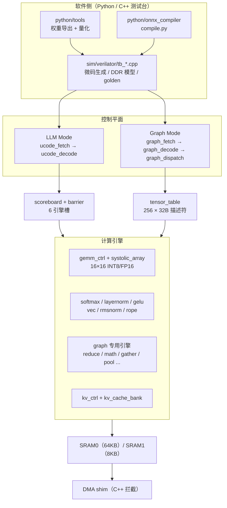
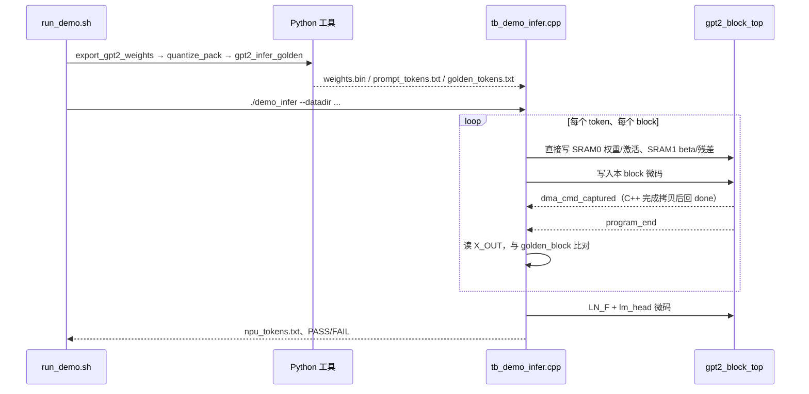
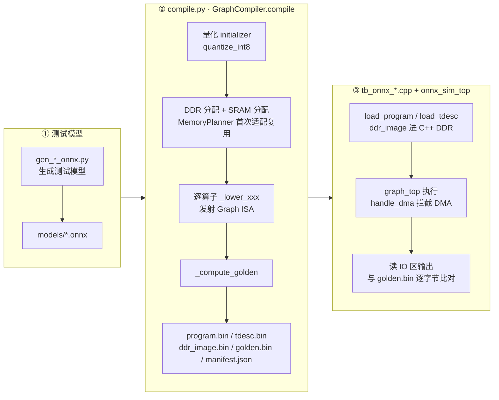
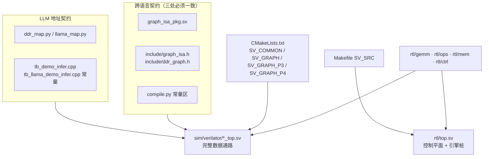

> 一份面向日常研发的 tiny-npu 说明书：解释它是什么、LLM Mode 与 Graph Mode 两条执行路径各自怎么从软件走到 RTL、仿真顶层和真正的芯片顶层差在哪里，以及排查问题时优先看哪些源码和文档。

源仓库：git@github.com:BeenLi/tiny-NPU.git

本次分析的本地路径：`<repo>`

本次分析的提交：8216c22 2026-02-16 Add Graph Mode Phase 4: FP16 pipeline, async dispatch, 13 engines, perf counters

## 1. 一句话理解 tiny-npu

tiny-npu 是一个用 SystemVerilog 写的教学型神经网络处理器（NPU），配套 Python 量化 / 编译工具和 Verilator + C++ 仿真环境，目标是让人从 RTL 层面看懂 NPU 如何执行 Transformer 和 ONNX 模型。核心计算是一个 16×16 权重驻留脉动阵列（`rtl/gemm/systolic_array.sv`），每个 PE 内含 INT8 和 FP16 两套 MAC（`rtl/gemm/pe.sv`），周围挂着 Softmax、LayerNorm、GELU、RMSNorm、RoPE 等定点引擎（`rtl/ops/`）。

仓库由四条主线组成：

- **RTL**（`rtl/`）：`pkg/` 放全局参数和两套 ISA；`ctrl/` 是 LLM Mode 的微码控制器（fetch → decode → scoreboard / barrier）和 KV cache 控制器；`graph/` 是 Graph Mode 的图流水线、张量描述符表和 13 个专用引擎；`gemm/`、`ops/`、`mem/`、`bus/` 分别是矩阵乘、向量 / 归一化算子、SRAM 与 KV cache、AXI 接口。
- **仿真**（`sim/verilator/`）：`CMakeLists.txt` 构建 21 个可执行目标，每个目标是一个 `*_top.sv` 仿真顶层加一个 `tb_*.cpp` 驱动；C++ 侧负责生成微码、扮演 DDR / DMA、跑 golden 模型并逐字节比对。
- **Python 工具链**（`python/`）：`tools/` 导出 HuggingFace 权重并量化打包成 `weights.bin`；`golden/` 是与 RTL 位精确对齐的参考实现；`onnx_compiler/compile.py` 把 ONNX 模型编译成 Graph ISA 程序、描述符表和 DDR 镜像。
- **模型与头文件**（`models/`、`include/`）：`gen_*_onnx.py` 生成的测试 ONNX 模型，以及 C++ 侧对 Graph ISA、DDR 地图的镜像定义（`include/graph_isa.h`、`include/ddr_graph.h`）。

它**不是**可直接上板的完整 SoC：芯片级顶层 `rtl/top.sv` 只接好了 AXI-Lite 寄存器、DMA、微码取指 / 译码和 scoreboard，Softmax / LayerNorm / GELU / Vec 用的是“延时后回 done”的桩，Graph Mode 状态寄存器也恒为 0；真正跑通模型的完整数据通路在 `sim/verilator/gpt2_block_top.sv`、`llama_block_top.sv`、`onnx_sim_top.sv` 这些仿真顶层里。核心输入是 INT8 量化权重（`weights.bin`）或编译产物（`program.bin` / `tdesc.bin` / `ddr_image.bin`），核心输出是 NPU 产生的 logits / token 或输出张量，以及与 golden 的比对结论（`PASS` / `max_err`）。

## 2. 核心心智模型

| 概念 | 来源 | 含义 |
|---|---|---|
| 两种执行模式 | `rtl/top.sv`、`rtl/bus/axi_lite_regs.sv` | `EXEC_MODE` 寄存器选择：0 = LLM Mode（微码），1 = Graph Mode（图 ISA）；两者共享计算引擎和 SRAM |
| 128-bit 微码指令 | `rtl/pkg/isa_pkg.sv`、`python/tools/ucode_asm.py` | LLM Mode 定长指令：opcode / flags / dst / src0 / src1 / M / N / K / imm；opcode 0–10 加 255 = END |
| Scoreboard + Barrier | `rtl/ctrl/scoreboard.sv`、`rtl/ctrl/barrier.sv`、`rtl/pkg/npu_pkg.sv` | 6 个引擎槽（`NUM_ENGINES = 6`，`ENG_GEMM` … `ENG_DMA`）的忙闲跟踪，LLaMA 另有 `ENG_RMSNORM` / `ENG_ROPE`；`BARRIER` 指令等所有引擎空闲再继续 |
| 128-bit Graph ISA | `rtl/graph/graph_isa_pkg.sv`、`include/graph_isa.h` | Graph Mode 指令用 8-bit 张量 ID 引用描述符，opcode 从 `OP_G_END = 0x00` 到 `OP_G_CAST = 0x7A` |
| 张量描述符表 | `rtl/graph/tensor_table.sv` | 256 项 × 256 bit，记录 DDR 地址、SRAM 地址、大小、4 维 shape、rank、dtype；3 读 1 写 |
| 图调度 FSM | `rtl/graph/graph_dispatch.sv` | `GD_IDLE → GD_FETCH_WAIT → GD_DECODE → GD_TDESC0/1/2 → GD_EXEC_xxx → GD_WAIT_DONE → GD_NEXT`，支持 SERIAL / OVERLAP 两种调度 |
| 权重驻留脉动阵列 | `rtl/gemm/systolic_array.sv`、`rtl/gemm/gemm_ctrl.sv` | 16×16 PE，`gemm_ctrl` 负责把大矩阵切成 16×16 tile 并沿 K 累加 |
| 定点重量化 | `rtl/gemm/gemm_post.sv`、`python/golden/quant.py` | INT32 累加结果按 `(acc * scale + round) >> shift` 截回 INT8，`imm` 高字节是 shift、低字节是 scale |
| SRAM0 / SRAM1 | `python/tools/ddr_map.py`、`sim/verilator/gpt2_block_top.sv` | SRAM0 64KB 放一个 block 的全部权重和激活；SRAM1 8KB 放 LN beta 和残差，便于 Vec 引擎同时读两路 |
| Head-blocked QKV 布局 | `python/tools/ddr_map.py` | Wq / Wk / Wv 各存 4 个连续 `[64,16]` 切片，第 h 个头的权重在 `Wq + h * 1024` |
| Follow-actual 验证 | `sim/verilator/tb_demo_infer.cpp` | 每个 block 用 NPU 实际输出喂给 C++ golden，比对下一步，避免舍入误差逐层累积 |
| 硬件 KV cache | `rtl/mem/kv_cache_bank.sv`、`rtl/ctrl/kv_ctrl.sv` | `KV_APPEND` / `KV_READ` 指令把 SRAM0 中的 K/V 打包进 128-bit 存储，与 DMA 共用 scoreboard 槽 |

## 3. 总体架构



图从上到下是一次推理的控制流向：软件侧准备权重或编译产物并由 C++ 测试台装进 RTL；LLM Mode 经微码控制器和 scoreboard 派发到引擎，Graph Mode 经图流水线查描述符表后派发；所有引擎都读写 SRAM0 / SRAM1，片外访问在仿真中由 C++ 的 DMA shim 拦截完成。图里的“控制平面”和“计算引擎”在 `rtl/top.sv` 中只部分连接，完整连接只存在于 `sim/verilator/*_top.sv` 仿真顶层（见第 11 节）。

### 3.1 组件职责

| 组件 | 关键文件 | 职责 |
|---|---|---|
| 全局参数与 ISA | `rtl/pkg/npu_pkg.sv`、`rtl/pkg/isa_pkg.sv`、`rtl/pkg/fixed_pkg.sv` | 阵列尺寸、位宽、引擎编号、LLM 微码格式与定点工具函数 |
| 主机接口 | `rtl/bus/axi_lite_regs.sv`、`rtl/bus/axi_dma_rd.sv`、`rtl/bus/axi_dma_wr.sv` | 控制寄存器（CTRL / STATUS / EXEC_MODE / GRAPH_*）和 AXI4 DMA 读写 |
| 微码控制器 | `rtl/ctrl/ucode_fetch.sv`、`rtl/ctrl/ucode_decode.sv`、`rtl/ctrl/scoreboard.sv`、`rtl/ctrl/barrier.sv` | LLM Mode 的取指、译码、按引擎派发与同步 |
| KV cache | `rtl/ctrl/kv_ctrl.sv`、`rtl/mem/kv_cache_bank.sv` | `KV_APPEND` / `KV_READ` 在 8-bit SRAM0 与 128-bit cache 间搬运 |
| GEMM | `rtl/gemm/gemm_ctrl.sv`、`rtl/gemm/systolic_array.sv`、`rtl/gemm/pe.sv`、`rtl/gemm/mac_int8.sv`、`rtl/gemm/mac_fp16.sv`、`rtl/gemm/gemm_post.sv` | tiling、脉动阵列、双精度 MAC、重量化 / FP16 旁路 |
| LLM 算子引擎 | `rtl/ops/softmax_engine.sv`、`rtl/ops/layernorm_engine.sv`、`rtl/ops/gelu_engine.sv`、`rtl/ops/vec_engine.sv`、`rtl/ops/rmsnorm_engine.sv`、`rtl/ops/rope_engine.sv` | 基于 LUT 的定点 Softmax / LN / GELU / SiLU，向量加乘与 COPY2D，LLaMA 用的 RMSNorm、RoPE |
| 图流水线 | `rtl/graph/graph_top.sv`、`rtl/graph/graph_fetch.sv`、`rtl/graph/graph_decode.sv`、`rtl/graph/graph_dispatch.sv`、`rtl/graph/tensor_table.sv` | Graph ISA 取指、译码、描述符查表、引擎编程、内联 EW 循环、性能计数、错误检测 |
| 图专用引擎 | `rtl/graph/reduce_engine.sv`、`rtl/graph/math_engine.sv`、`rtl/graph/gather_engine.sv`、`rtl/graph/slice_engine.sv`、`rtl/graph/concat_engine.sv`、`rtl/graph/avgpool2d_engine.sv`、`rtl/graph/maxpool2d_engine.sv`、`rtl/graph/pad_engine.sv`、`rtl/graph/resize_nearest_engine.sv`、`rtl/graph/cast_engine.sv` | ONNX 算子的硬件实现；`fp16_utils.sv` 和 `graph_*_lut*.sv` 提供 FP16 运算和查找表 |
| 存储 | `rtl/mem/sram_dp.sv`、`rtl/mem/banked_sram.sv`、`rtl/mem/tile_buffer.sv` | 双口 SRAM 原语、多 bank 封装、尚未接入 GEMM 的乒乓 tile 缓冲 |
| 仿真顶层 | `sim/verilator/gpt2_block_top.sv`、`sim/verilator/llama_block_top.sv`、`sim/verilator/onnx_sim_top.sv`、`sim/verilator/engine_tb_top.sv`、`sim/verilator/integration_top.sv` | 把控制平面、真实引擎、SRAM 和 DMA shim 接在一起，暴露给 C++ |
| 仿真驱动 | `sim/verilator/tb_*.cpp`、`sim/verilator/CMakeLists.txt` | 生成微码 / 加载编译产物、模拟 DDR、运行 golden 并判定 PASS |
| 权重与 golden | `python/tools/export_gpt2_weights.py`、`python/tools/quantize_pack.py`、`python/golden/gpt2_infer_golden.py`、`python/tools/llama_gen_weights*.py` | 导出 / 量化 / 打包权重，生成 prompt、golden token 与 logits |
| ONNX 编译器 | `python/onnx_compiler/compile.py` | 量化、DDR / SRAM 分配、描述符表、算子 lowering、golden 计算与产物落盘 |

## 4. 项目如何工作

### 4.1 LLM Mode：GPT-2 端到端推理（`run_demo.sh` → `demo_infer`）



这张图是 GPT-2 demo 一次运行中各方的交互顺序：Python 只在开始时产出一次数据文件，之后每个 token、每个 block 都由 C++ 测试台装载 SRAM、写微码、启动 RTL，并在 RTL 发出 `program_end` 后读回结果比对。

1. `sim/verilator/run_demo.sh` 解析 `--prompt`、`--max-tokens`、`--temperature`、`--seed`、`--kv-cache`、`--skip-python`；没加 `--skip-python` 时依次调用 `python/tools/export_gpt2_weights.py`（导出 HuggingFace GPT-2 的前 64 维 / 前 4 层）、`python/tools/quantize_pack.py`（INT8 量化并打包为 `weights.bin`）、`python/golden/gpt2_infer_golden.py`（生成 `prompt_tokens.txt` 和 golden token）。
2. 脚本在 `sim/verilator/build` 下 `cmake ..` 并只构建 `demo_infer` 目标。`sim/verilator/CMakeLists.txt` 把 `gpt2_block_top` 以 `SRAM0_DEPTH=65536`、`SRAM1_DEPTH=8192` 编译成静态库 `gpt2_demo_verilated`，`demo_infer` 和 `kv_cache_sim` 共用这个库。
3. `sim/verilator/tb_demo_infer.cpp` 的 `main` 读 `--datadir` 下的 `weights.bin`，用 `load_weights` 校验文件大小必须等于 `WEIGHTS_TOTAL`，再用 `compute_embeddings` 在 C++ 中算 token + position embedding。
4. 对每个 block，`tb_demo_infer.cpp` 的 `load_block_to_srams` 通过测试台端口**直接写** SRAM0（Wq/Wk/Wv/Wo/W1/W2 和输入 X）与 SRAM1（LN beta 和残差副本），不经过 DMA。
5. `gen_block_microcode`（整段重算）或 `gen_prefill_block_microcode` / `gen_decode_block_microcode`（KV cache 模式）按 `python/tools/ddr_map.py` 同款地址常量生成 128-bit 微码：每行一条 `LAYERNORM`，再对 4 个头逐个执行 Q/K/V GEMM → 打分 GEMM（`TRANSPOSE_B`）→ 带 causal mask 的 `SOFTMAX` → 上下文 GEMM → `VEC` COPY2D 拼回 ATTN，接着是 Wo、残差、LN2、FFN、GELU、残差，步骤之间插 `BARRIER`。
6. `tb_demo_infer.cpp` 的 `run_until_done` 每拍 `tick()`；`sim/verilator/gpt2_block_top.sv` 拉高 `dma_cmd_captured` 时 `handle_dma_command` 在 C++ 中把 SRAM0 的数据拷到 SRAM1 并回 `dma_done_pulse`；看到 `program_end` 后返回周期数。
7. `tb_demo_infer.cpp` 的 `read_block_output` 从 `ADDR_X_OUT` 读回结果，`golden_block` 用同一输入算 C++ golden 并比对；下一 block 用 NPU 的实际输出继续（follow-actual）。
8. 4 个 block 之后用 `gen_ln_f_microcode` 和 `gen_lm_head_microcode` 算 logits，`sample_token` 采样下一个 token，写入 `npu_tokens.txt`；`run_demo.sh` 最后用 GPT-2 tokenizer 把 token 解码回文本。

### 4.2 LLM Mode：KV cache 路径

1. `tb_demo_infer.cpp` 带 `--kv-cache` 时，prefill 阶段用 `gen_prefill_block_microcode` 在算出每个头的 K_H / V_H 后插入 `KV_APPEND`（`M` = 层号，`K` = 时间位置，`imm` = 头号）。
2. decode 阶段 `tb_demo_infer.cpp` 的 `gen_decode_block_microcode` 只为新 token（M=1）算 Q/K/V，`KV_APPEND` 追加后用 `KV_READ` 把 `[0..T]` 的 K/V 读回 SRAM0，再做 `[1,16] × [T+1,16]^T` 的注意力。
3. `rtl/ctrl/ucode_decode.sv` 把 KV 指令派发给 `rtl/ctrl/kv_ctrl.sv`；后者在 SRAM0 的 8-bit 端口和 `rtl/mem/kv_cache_bank.sv` 的 128-bit 向量之间打包 / 拆包，与 DMA 共用 scoreboard 的 5 号槽并互斥。
4. `sim/verilator/tb_kv_cache_sim.cpp` 专门验证：prefill 与整段重算的 block 输出和 logits 都要 `max_err=0`，decode 一步后也要一致。

### 4.3 Graph Mode：ONNX 编译到仿真



这张图把 Graph Mode 分成三段从左到右读：① 生成脚本产出 ONNX 模型；② 编译器四步得到五个产物；③ 仿真端把产物装进 RTL 运行并比对 golden。每段内部从上到下是时间顺序。编译器和 RTL 之间唯一的契约是 Graph ISA 编码与描述符格式，三处定义必须一致（见第 11 节）。

1. `python/onnx_compiler/gen_mlp_onnx.py` 等脚本把小模型写进 `models/`。
2. `python/onnx_compiler/compile.py` 的 `main` 读 `--model`、`--outdir`、`--no-reuse`，构造 `GraphCompiler`。`compile()` 依次：对 float initializer 做 `quantize_int8`（逐张量对称量化）；为权重和输入分配 DDR（输入是 `np.random.seed(99)` 生成的随机数据）；为输入分配 SRAM 并登记描述符；做 liveness 分析得到每个张量的最后使用位置。
3. `compile.py` 的 `GraphCompiler.compile` 按 `op.op_type` 分派到 `_lower_gemm`、`_lower_conv`（im2col 在编译期展开到 DDR）、`_lower_reduce`、`_lower_math`、`_lower_gather`、`_lower_slice`、`_lower_concat`、`_lower_batchnorm`（转成 EW_MUL + EW_ADD）、`_lower_avgpool2d`、`_lower_maxpool2d`、`_lower_pad`、`_lower_resize_nearest`、`_lower_clip`（转成 EW_MAX + EW_MIN）等；不支持的算子只打印 `WARNING: Unsupported op` 后跳过。启用复用时，张量在最后一次使用后由 `_free_sram` 释放。
4. 输出张量的描述符被改写到 `DDR_GRAPH_IO_BASE`（定义见 `include/ddr_graph.h`），追加 `OP_G_DMA_STORE` 和 `OP_G_END`；`_compute_golden` 用 INT8 + INT32 累加计算期望输出；`write_outputs` 写出五个产物。
5. `sim/verilator/tb_onnx_smoke.cpp`（其他 `tb_onnx_*.cpp` 结构相同）用 `load_file_to_ddr` 把 `ddr_image.bin` 装进 C++ 字节数组，`load_program` 通过 `prog_wr_*` 端口写程序 SRAM，`load_tdesc` 写描述符表，然后拉 `start_pulse`。
6. `rtl/graph/graph_top.sv` 内的 `graph_fetch` 顺序取指，`graph_decode` 组合译码成 `graph_instr_t`，`rtl/graph/graph_dispatch.sv` 用 3 拍（`GD_TDESC0/1/2`）读出 src0 / src1 / dst 描述符，再进入对应的 `GD_EXEC_xxx`：DMA 交给 shim，GEMM 编程 `gemm_ctrl`，EW / ReLU 在 FSM 内逐元素循环，其余算子编程对应引擎并在 `GD_WAIT_DONE` 等 done。
7. 测试台每拍调用 `handle_dma`，按 `dma_direction` / `dma_strided` 在 C++ DDR 与 SRAM0 之间搬数据；`graph_done` 拉高后读 IO 区输出，与 `golden.bin` 逐字节比对。

## 5. 安装与启动

以下命令来自 `README.md` 的 “Simulation → Prerequisites / Build” 一节。README 中的 `npu/` 指本仓库根目录 `<repo>`（仓库里没有名为 `npu` 的子目录），执行时把 `cd npu` 换成 `cd <repo>`。

依赖安装（出处：`README.md` “Prerequisites”）：

```bash
sudo apt update
sudo apt install -y build-essential cmake python3 python3-pip verilator

pip3 install numpy transformers huggingface_hub safetensors
pip3 install onnx
```

`python/requirements.txt` 列的是 `transformers>=4.30.0`、`torch>=2.0.0`、`numpy>=1.24.0`、`scipy>=1.10.0`，**没有** `onnx`、`huggingface_hub`、`safetensors`；`run_demo.sh` 只在 `import transformers` 失败时自动 `pip3 install -r` 这个文件。Graph Mode 需要单独安装 `onnx`（`compile.py` 导入失败时会提示 `pip install onnx`）。

CMake 构建全部 21 个仿真目标（出处：`README.md` “Build”，路径按本仓库调整）：

```bash
cd <repo>/sim/verilator
mkdir -p build && cd build
cmake ..
cmake --build . -j$(nproc)
```

`sim/verilator/CMakeLists.txt` 通过 `find_package(verilator HINTS $ENV{VERILATOR_ROOT})` 找 Verilator，找不到时直接报 `Verilator not found. Set VERILATOR_ROOT or add to PATH.`。

根目录 `Makefile` 提供另一套入口（出处：`Makefile` 的 `help` 目标）：

```bash
make help        # 列出所有目标
make cmake_sim   # 在 build/cmake 下走 CMake 构建
make test        # cd python && python3 -m tests.test_end2end（Python golden 自测）
make luts        # python/tools/make_lut.py -o rtl/ops --format both
make lint        # verilator --lint-only
make ucode       # python/tools/ucode_asm.py --gen-tiny --hex -o build/ucode.hex
```

最小冒烟（出处：`README.md` “Run Unit Tests (LLM Mode)”，这四个目标不需要外部数据）：

```bash
cd <repo>/sim/verilator/build
./npu_sim
./engine_sim
./integration_sim
./gpt2_block_sim
```

## 6. 常用命令 / 使用指南

下面命令中的 `<repo>` 代入仓库根目录；README 原文写作 `cd npu`。

### 6.1 GPT-2 推理 demo

出处：`README.md` “Run GPT-2 Inference Demo” 与 `sim/verilator/run_demo.sh` 头注释。

```bash
cd <repo>/sim/verilator
./run_demo.sh --prompt "Hello" --max-tokens 10
./run_demo.sh --prompt "Hello" --max-tokens 10 --temperature 0.8 --seed 42
./run_demo.sh --prompt "Hello" --max-tokens 10 --temperature 0.8 --kv-cache
./run_demo.sh --prompt "Hello" --max-tokens 10 --skip-python
```

分步执行（出处：`README.md` “Option B: Step-by-step”）：

```bash
cd <repo>
DEMO_OUTDIR=sim/verilator/build/demo_data python3 python/tools/export_gpt2_weights.py
DEMO_OUTDIR=sim/verilator/build/demo_data python3 python/tools/quantize_pack.py
DEMO_OUTDIR=sim/verilator/build/demo_data python3 python/golden/gpt2_infer_golden.py \
    --prompt "Hello" --max-tokens 10 --temperature 0.8 --seed 42 \
    --outdir sim/verilator/build/demo_data
cd sim/verilator/build
cmake --build . --target demo_infer -j$(nproc)
./demo_infer --datadir demo_data --max-tokens 10 --temperature 0.8 --seed 42
./demo_infer --datadir demo_data --max-tokens 10 --temperature 0.8 --seed 42 --kv-cache
```

### 6.2 LLaMA / Mistral / Qwen2 demo

出处：`README.md` “Run LLaMA Inference Demo”。四种数据都由同一个 `llama_demo_infer` 运行。

```bash
cd <repo>/python/tools
python3 llama_gen_weights.py --outdir ../../sim/verilator/build/llama_demo_data
python3 llama_gen_weights_hf.py --outdir ../../sim/verilator/build/llama_demo_data_hf
python3 mistral_gen_weights_hf.py --outdir ../../sim/verilator/build/mistral_demo_data
python3 qwen_gen_weights_hf.py --outdir ../../sim/verilator/build/qwen_demo_data

cd ../../sim/verilator/build
./llama_demo_infer --datadir llama_demo_data
```

`llama_gen_weights.py` 只依赖 numpy，产出 `weights.bin`、`prompt_tokens.txt`、`golden_tokens.txt`、`golden_logits.bin`；`*_hf.py` 需要 `huggingface_hub` 和 `safetensors`。

### 6.3 ONNX Graph Mode：编译并运行

出处：`README.md` “Run ONNX Graph Mode Tests”。

```bash
cd <repo>
python3 python/onnx_compiler/gen_mlp_onnx.py
python3 python/onnx_compiler/compile.py \
    --model models/mlp_32_16_8.onnx \
    --outdir sim/verilator/build/graph
cd sim/verilator/build
./onnx_smoke_sim --datadir graph
```

其他模型同理，`gen_xxx_onnx.py` → `compile.py --model models/xxx.onnx --outdir sim/verilator/build/graph_xxx` → `./onnx_xxx_sim --datadir graph_xxx`。模型名与目标的对应见 `README.md` 的 21 个目标表。fuzz 用例需要循环编译 50 次（出处：`README.md` “Fuzz Test”）：

```bash
python3 python/onnx_compiler/gen_fuzz_onnx.py
for i in $(seq 0 49); do
    python3 python/onnx_compiler/compile.py \
        --model models/fuzz/case_${i}.onnx \
        --outdir sim/verilator/build/graph_fuzz/case_${i}
done
cd sim/verilator/build && ./onnx_fuzz_sim --datadir graph_fuzz
```

### 6.4 KV cache 正确性与全量回归

出处：`README.md` “Run KV Cache Correctness Test” 与 `sim/verilator/regression_all.sh`。

```bash
cd <repo>/sim/verilator/build
./kv_cache_sim --datadir demo_data

cd <repo>/sim/verilator
./regression_all.sh
```

`regression_all.sh` 要求 `build/` 已存在；未构建的目标记为 `[SKIP]`，每个目标的输出写到 `build/<name>.log`。

### 6.5 波形调试

出处：`README.md` “Debug with Waveforms”。

```bash
NPU_DUMP=1 ./demo_infer --datadir demo_data --max-tokens 1
gtkwave demo_infer.vcd &
```

## 7. 配置项与环境变量

| 配置项 | 默认值 | 定义位置 | 作用 |
|---|---|---|---|
| `DEMO_OUTDIR`（环境变量） | `$BUILD_DIR/demo_data`（脚本）；`.`（Python） | `sim/verilator/run_demo.sh`；`python/tools/export_gpt2_weights.py` 的 `main`；`python/tools/quantize_pack.py`、`python/golden/gpt2_infer_golden.py` 的参数处理 | GPT-2 数据目录；`tb_demo_infer.cpp`、`tb_kv_cache_sim.cpp`、`tb_llama_demo_infer.cpp` 的 `main` 也读它作为 datadir 的初值 |
| `NPU_DUMP`（环境变量） | 未设置即关闭 | `tb_demo_infer.cpp` / `tb_llama_demo_infer.cpp` 的 `main` | 打开 DMA 日志和 VCD 波形 |
| `DUMP_FFN`（环境变量） | 未设置即关闭 | `sim/verilator/tb_gpt2_block.cpp` 文件头静态常量 | 打印 FFN 中间结果 |
| `DUMP_DEBUG`（环境变量） | 未设置即关闭 | `sim/verilator/tb_llama_block.cpp` 文件头静态常量 | LLaMA block 调试输出 |
| `VERILATOR_ROOT`（环境变量） | 无 | `sim/verilator/CMakeLists.txt` 的 `find_package` | Verilator 安装位置提示 |
| `VERILATOR` / `PYTHON`（make 变量） | `verilator` / `python3` | `Makefile` 顶部 | 覆盖工具路径 |
| `--datadir`（tb 参数） | 例如 `build/graph_fp16_smoke`、`build/graph_mixed_cnn` | 各 `tb_onnx_*.cpp` 的静态变量 `g_datadir` | 编译产物或权重目录 |
| `--model` / `--outdir` / `--no-reuse` | 必填 / `build/graph` / 关 | `python/onnx_compiler/compile.py` 的 `main` | 编译输入、输出目录、关闭 SRAM 复用（改用 bump 分配） |
| `scheduler_mode`（仿真端口） | 测试台中均设为 `0` | `rtl/graph/graph_top.sv` 端口；各 `tb_onnx_*.cpp` 的 `main` | 0 = SERIAL，1 = OVERLAP |
| `MAX_CYCLES_PER_OP` | `1000000` | `rtl/graph/graph_dispatch.sv` 模块参数 | 单条指令超时，超时报 `GERR_TIMEOUT` |
| `ARRAY_M` / `ARRAY_N` | `16` / `16` | `rtl/pkg/npu_pkg.sv` | 脉动阵列尺寸；`systolic_array.sv` 自带参数 `M` / `N` 默认也是 16 |
| `SRAM0_DEPTH` / `SRAM1_DEPTH` | 模块默认 `8192` / `4096`，CMake 覆盖为 `65536` / `8192` | `sim/verilator/gpt2_block_top.sv` 参数；`CMakeLists.txt` 的 `-G` 参数 | 仿真中 SRAM 容量 |
| `MAX_LAYERS` / `MAX_HEADS` / `MAX_SEQ` / `HEAD_DIM` | `4` / `4` / `512` / `16` | `rtl/mem/kv_cache_bank.sv` 参数 | KV cache 容量 |
| `DDR_GRAPH_*_BASE` | PROG `0x00100000`，TDESC `0x00200000`，DATA `0x00300000`，IO `0x00400000`，SCRATCH `0x00500000` | `include/ddr_graph.h`；`compile.py` 常量区 | Graph Mode DDR 镜像布局 |
| `GEMM_SHIFT` / `GEMM_SCALE` | `9` / `1` | `python/tools/ddr_map.py` | GPT-2 K=64 时的重量化参数，`GEMM_IMM = (GEMM_SHIFT << 8) \| GEMM_SCALE` |
| `HIDDEN` / `N_HEADS` / `FFN_DIM` / `N_LAYERS` / `VOCAB_SIZE` / `MAX_SEQ` | `64` / `4` / `256` / `4` / `256` / `16` | `python/tools/ddr_map.py` | GPT-2 缩小版模型配置，C++ 测试台中有同名常量 |

## 8. 常见使用场景 / 推荐工作流

1. **第一次上手，确认环境可用**：按第 5 节装依赖、CMake 构建，然后跑 `./npu_sim`、`./engine_sim`、`./integration_sim`、`./gpt2_block_sim`（不需要任何数据文件），再跑 `./run_demo.sh --prompt "Hello" --max-tokens 10` 看完整 GPT-2 流程。
2. **学习 LLM Mode 的微码**：读 `README.md` “Transformer Block” 一节的汇编清单，再对照 `sim/verilator/tb_demo_infer.cpp` 的 `gen_block_microcode`（真正生成微码的地方）和 `rtl/ctrl/ucode_decode.sv`（如何派发）。用 `NPU_DUMP=1 ./demo_infer --datadir demo_data --max-tokens 1` 打出波形看引擎时序。
3. **新增一个 ONNX 算子**：在 `rtl/graph/graph_isa_pkg.sv`、`include/graph_isa.h`、`python/onnx_compiler/compile.py` 三处加 opcode；在 `rtl/graph/` 写引擎并在 `graph_dispatch.sv` 加 `GD_EXEC_xxx` 状态；在 `sim/verilator/onnx_sim_top.sv` 实例化并加入 SRAM0 仲裁；在 `CMakeLists.txt` 的 `SV_GRAPH_P4`（或新列表）登记源文件；写 `gen_xxx_onnx.py` 和 `tb_onnx_xxx.cpp`，再把新 case 加进 `gen_fuzz_onnx.py`。
4. **验证编译器改动**：改 `compile.py` 后，至少重编并重跑 `onnx_smoke_sim`、`onnx_cnn_smoke_sim` 和 50 个 fuzz 用例（第 6.3 节命令）；怀疑 SRAM 复用出错时用 `--no-reuse` 对照。
5. **换一个 LLaMA 系列模型**：仿照 `python/tools/qwen_gen_weights_hf.py` 写导出脚本，输出与 `llama_gen_weights.py` 相同的四个文件，然后 `./llama_demo_infer --datadir <新目录>`；只要结构仍是 RMSNorm + RoPE + GQA + SwiGLU，不用改 RTL。
6. **提交前回归**：`cd <repo>/sim/verilator && ./regression_all.sh`，对照输出中的 `[SKIP]` 确认需要的数据目录都已生成（目录名见第 12 节的差异说明）。

## 9. 源码入口索引

| 想了解 | 优先看 |
|---|---|
| 项目全貌、ISA 表、内存地图 | `README.md` |
| 芯片级顶层与寄存器 | `rtl/top.sv`、`rtl/bus/axi_lite_regs.sv` |
| LLM 微码格式与 opcode | `rtl/pkg/isa_pkg.sv`、`python/tools/ucode_asm.py` |
| 微码如何派发到引擎 | `rtl/ctrl/ucode_decode.sv`、`rtl/ctrl/scoreboard.sv`、`rtl/ctrl/barrier.sv` |
| 一个 GPT-2 block 的微码是怎么生成的 | `sim/verilator/tb_demo_infer.cpp` 的 `gen_block_microcode` |
| GPT-2 block 的完整硬件连接 | `sim/verilator/gpt2_block_top.sv` |
| LLaMA 专用硬件（RMSNorm / RoPE / SiLU） | `sim/verilator/llama_block_top.sv`、`rtl/ops/rmsnorm_engine.sv`、`rtl/ops/rope_engine.sv`、`rtl/ops/silu_lut.sv` |
| 矩阵乘如何切 tile、如何重量化 | `rtl/gemm/gemm_ctrl.sv`、`rtl/gemm/gemm_post.sv` |
| KV cache | `rtl/ctrl/kv_ctrl.sv`、`rtl/mem/kv_cache_bank.sv`、`sim/verilator/tb_kv_cache_sim.cpp` |
| Graph ISA 与描述符格式 | `rtl/graph/graph_isa_pkg.sv`、`include/graph_isa.h`、`include/ddr_graph.h` |
| 图调度状态机与性能计数 | `rtl/graph/graph_dispatch.sv` |
| Graph Mode 的完整硬件连接与 SRAM 仲裁 | `sim/verilator/onnx_sim_top.sv` |
| ONNX 算子如何 lowering | `python/onnx_compiler/compile.py` 的 `GraphCompiler._lower_xxx` |
| 定点算法的参考实现 | `python/golden/softmax_ref.py`、`python/golden/layernorm_ref.py`、`python/golden/gemm_ref.py`、`python/golden/quant.py` |
| 权重文件布局 | `python/tools/ddr_map.py`、`python/tools/llama_map.py`、`python/tools/kv_map.py` |
| 构建了哪些目标、各用哪些 RTL | `sim/verilator/CMakeLists.txt` |

## 10. 排错指南

| 现象 | 优先检查 | 依据 |
|---|---|---|
| CMake 报 `Verilator not found` | Verilator 是否在 PATH，或设置 `VERILATOR_ROOT` | `sim/verilator/CMakeLists.txt` 的 `find_package` |
| `compile.py` 报 `onnx package required` | `pip3 install onnx`；`requirements.txt` 里没有它 | `python/onnx_compiler/compile.py` 文件头的 import |
| `demo_infer` 报 `weights.bin size ... != expected` | `ddr_map.py` 与 `tb_demo_infer.cpp` 中的模型尺寸是否一致；重跑 `quantize_pack.py` | `tb_demo_infer.cpp` 的 `load_weights` |
| ONNX 测试找不到 `program.bin` 等文件 | `--datadir` 是否指向 `compile.py --outdir` 的目录；各 tb 的默认 `g_datadir` 是相对路径 | `tb_onnx_*.cpp` 的 `main` |
| `regression_all.sh` 某目标 FAIL 而手动跑能过 | 脚本里的数据目录名（如 `llama_data`、`graph_batchnorm_pool`）与 README 生成命令里的名字（`llama_demo_data`、`graph_bn_pool`）不同 | `sim/verilator/regression_all.sh`、`README.md` |
| 编译结果缺了某个算子的指令 | 编译日志中的 `WARNING: Unsupported op`；该算子会被静默跳过，golden 与硬件都可能缺这一步 | `GraphCompiler.compile` 的 `else` 分支 |
| Graph Mode 卡死或报错 | 读 `graph_dispatch` 的错误码：`GERR_BAD_OPCODE`、`GERR_SHAPE_MISMATCH`、`GERR_TIMEOUT` | `rtl/graph/graph_isa_pkg.sv`、`rtl/graph/graph_dispatch.sv` |
| 怀疑 SRAM 复用导致数据被覆盖 | 用 `compile.py --no-reuse` 重编对比 | `compile.py` 的 `MemoryPlanner` 与 `main` |
| 在 `rtl/top.sv` 上跑完整推理得不到正确结果 | `top.sv` 只有引擎 done 桩，真实引擎在仿真顶层 | `rtl/top.sv` 的 “Engine stubs” 注释 |
| `make sim` 构建失败 | 根目录 `Makefile` 的 `SV_SRC` 没有 `mac_fp16.sv`、`fp16_utils.sv`，而 `pe.sv` 实例化了 `mac_fp16`；优先用 CMake | `Makefile`、`rtl/gemm/pe.sv` |
| 想看波形但没有 VCD | 设置 `NPU_DUMP=1` 后再运行 demo | `tb_demo_infer.cpp` 的 `main` |

## 11. 开发者视角的模块关系 / 维护注意点



这张图标出了改动时最容易漏同步的地方：上面两组是跨语言的“契约”（Graph ISA 编码、权重 / SRAM 地址），中间是共享 RTL 被两种顶层复用，下面是两套构建清单分别喂给不同顶层。

维护时要注意：

- **Graph ISA 有三份定义**：`rtl/graph/graph_isa_pkg.sv`、`include/graph_isa.h`、`python/onnx_compiler/compile.py` 常量区。加 opcode、改 flag 位、改描述符字段时三处同时改，否则编译器发出的指令在 RTL 中会落到 `GERR_BAD_OPCODE`，或描述符字段错位。
- **SRAM 地址常量有两份**：Python 的 `python/tools/ddr_map.py` / `llama_map.py` / `kv_map.py` 与 C++ 测试台中的同名常量（`tb_demo_infer.cpp` 注释写明 “must match ddr_map.py”）。改模型尺寸或内存地图要两边一起改。
- **两套顶层**：`rtl/top.sv` 是芯片级外壳，`sim/verilator/*_top.sv` 才把真实引擎接上。在 `rtl/ops/` 或 `rtl/gemm/` 改了端口，要同时检查 `gpt2_block_top.sv`、`llama_block_top.sv`、`engine_tb_top.sv`、`integration_top.sv`、`onnx_sim_top.sv`，它们各自手工连线。
- **两套构建清单**：`sim/verilator/CMakeLists.txt` 是事实上的主构建；根目录 `Makefile` 的 `SV_SRC` 是更早的清单，缺少 Graph、KV、FP16 相关文件。新增 RTL 文件至少要加进 CMake 的对应列表。
- **共享 Verilated 库**：`gpt2_demo_verilated`、`llama_verilated`、`onnx_sim_verilated` 三个静态库被多个可执行文件链接。改了 `onnx_sim_top.sv` 会同时影响 13 个 Graph Mode 测试，改顶层参数要改 CMake 里的 `-G` 参数而不是测试台。
- **SRAM0 仲裁优先级**：`onnx_sim_top.sv` 文件头写明 `gp_ew > gm > sm > re > me > ga > sl > ct > ap > mp > pd > rz > ca > tb`，按 `rd_en` / `wr_en` 而非 `busy` 仲裁。新引擎接入时要插进这个优先级链，并确认不会和 DMA 在 OVERLAP 模式下冲突。
- **golden 必须与 RTL 逐位一致**：`compile.py` 的 `_compute_golden`、`python/golden/*.py`、测试台里的 C++ golden（如 `softmax_golden`、`layernorm_golden`）各自复刻了 RTL 的舍入和 LUT。改 RTL 定点细节时三处 golden 都要跟着改。
- **LUT 文件**：`make luts` 会向 `rtl/ops/` 写 `.mem` 和 `*_init.sv`，`make clean` 会删掉它们；`scripts/gen_math_luts.py` 与 `python/tools/make_fp16_lut.py` 生成 Graph Mode 的数学 LUT，改 LUT 算法后要重新生成并检查 `graph_*_lut*.sv`。

## 12. 已知不确定点

- 本次为静态源码分析，未执行任何构建、仿真、Python 脚本或测试；文中 “PASS”“bit-exact”“1.8x 加速”等结论均引自 `README.md`，未在本机复现。
- `README.md` 所有命令都写作 `cd npu` / `npu/sim/verilator`，但本仓库根目录就是工程根，没有 `npu/` 子目录；本文统一按 `<repo>` 改写，是否存在其他布局未核实。
- `README.md` 称 Graph Mode 能自动推断 dtype 并插入 `OP_G_CAST`，但 `python/onnx_compiler/compile.py` 只定义了 `OP_G_CAST`、`DTYPE_FP16` 常量，分派表里没有 `Cast`、`Softmax` 的 lowering，也没有发射 CAST 的代码；`gen_fp16_smoke_onnx.py` 的文档字符串自己写着 “For now this generates an INT8 model”。FP16 / Cast 路径目前是否被端到端覆盖存疑。
- `tb_onnx_overlap_perf.cpp` 注释说对比 SERIAL 与 OVERLAP，但所有 `tb_onnx_*.cpp` 中只看到 `dut->scheduler_mode = 0`；OVERLAP 模式是否有测试覆盖未找到证据。
- `rtl/top.sv` 中 Graph Mode 的 `graph_status_w` 等信号固定为 0（注释 “tied to 0 until graph_top is instantiated”），Softmax / LayerNorm / GELU / Vec 是定时回 done 的桩；`README.md` 的 Vivado 综合步骤以 `top` 为顶层，综合出来的电路不包含完整数据通路。
- README 描述 LLM Mode 由主机通过 DMA 从 DDR 加载每层权重，但 `tb_demo_infer.cpp` 的 `load_block_to_srams` 是测试台直接写 SRAM，DMA shim 只做 SRAM0 → SRAM1 的拷贝；真实主机流程未实现。
- 根目录 `Makefile` 的 `SV_SRC` 缺少 `rtl/gemm/mac_fp16.sv` 与 `rtl/graph/fp16_utils.sv`，而 `rtl/gemm/pe.sv` 实例化了 `mac_fp16`，推测 `make sim` / `make lint` 会失败，未实际验证。
- `regression_all.sh` 使用的数据目录（`llama_data`、`graph_batchnorm_pool`）与 README 生成命令（`llama_demo_data`、`graph_bn_pool`）不一致；README 回归清单中的 `onnx_resize_pad_sim --datadir graph_resize_pad` 也没有对应的编译命令（`gen_resize_pad_onnx.py` 存在但 README 未给出用法）。
- `compile.py` 把 ONNX `Reciprocal` 映射到 `OP_G_RSQRT`，语义上是倒数平方根而不是倒数，是否为有意近似未核实。
- `make test` 运行的 `python/tests/test_end2end.py` 文件头说会与 RTL 仿真结果比较，但文件里 `import subprocess` 后没有任何 `subprocess.` 调用，看起来只是 Python golden 模型之间的自测，不触发仿真。
